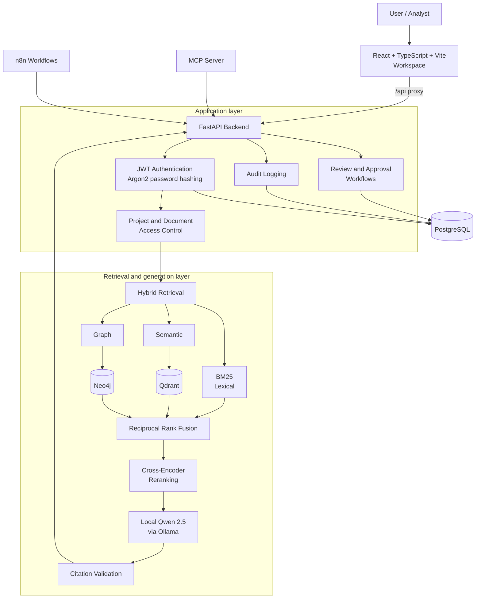
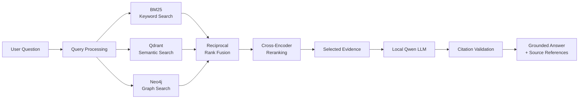
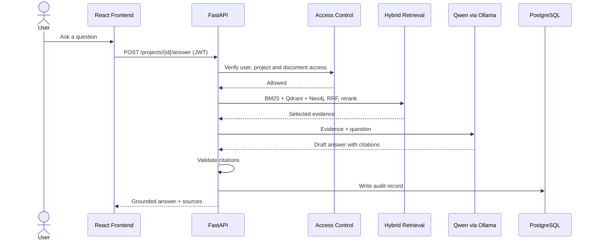
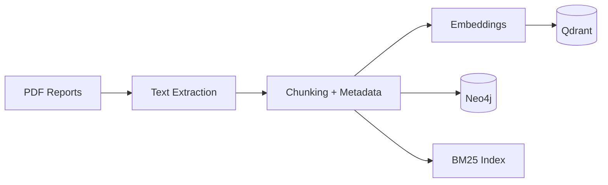

# NexaGraph 2.0

### Hybrid GraphRAG platform for grounded, cited answers over long documents

> NexaGraph fuses **lexical (BM25)**, **semantic (Qdrant)** and **graph (Neo4j)** retrieval with **Reciprocal Rank Fusion** and **cross-encoder reranking**, then generates cited answers with a **local Qwen model**. Around the retrieval core sits an application layer with **JWT authentication, project and document access control, manager approval workflows, audit logging, an MCP server and n8n automation**.

[](https://www.python.org/)
[](https://fastapi.tiangolo.com/)
[](https://react.dev/)
[](https://qdrant.tech/)
[](https://neo4j.com/)
[](https://www.postgresql.org/)
[](https://ollama.com/)
[](https://modelcontextprotocol.io/)

| Corpus | Retrieval signals | Best method (Benchmark v3) | Recall@5 | MRR | nDCG@5 | Answer model |
|:---:|:---:|:---:|:---:|:---:|:---:|:---:|
| 5 Siemens 2025 reports (~1,678 chunks) | BM25 + Semantic + Graph | **Hybrid RRF** | **52.78%** | **0.6528** | **0.4389** | Qwen 2.5 via Ollama |

> **Repository scope:** This repository contains selected source code from NexaGraph 2.0 together with its architecture, evaluation results and design notes. It does not contain credentials, databases, the original document corpus or internal workflow exports, and it is not a one-click runnable distribution.

---

## Table of Contents

- [Key Findings](#key-findings)
- [Why NexaGraph?](#why-nexagraph)
- [Core Capabilities](#core-capabilities)
- [System Architecture](#system-architecture)
- [Retrieval Pipeline](#retrieval-pipeline)
- [Request Lifecycle](#request-lifecycle)
- [Document Ingestion](#document-ingestion)
- [Evaluation](#evaluation)
- [Security and Governance](#security-and-governance)
- [MCP and Workflow Automation](#mcp-and-workflow-automation)
- [Technology Stack](#technology-stack)
- [Design Decisions](#design-decisions)
- [Running Locally](#running-locally)
- [API Overview](#api-overview)
- [Testing](#testing)
- [Project Structure](#project-structure)
- [Limitations](#limitations)
- [Future Work](#future-work)
- [Author](#author)

---

## Key Findings

1. **Hybrid retrieval beat every single method.** Reciprocal Rank Fusion scored highest on Recall@5, MRR and nDCG@5.
2. **Lexical beat semantic on this corpus.** BM25 outperformed embedding retrieval, which fits documents full of exact figures, names and technical terms.
3. **More machinery did not mean better results.** The cross-encoder reranker lowered aggregate scores compared with Hybrid RRF, so it is flagged for investigation rather than presented as an improvement.
4. **The evidence is preliminary.** Six benchmark cases support a direction, not a general claim.

---

## Why NexaGraph?

A conventional RAG system is a single retrieval call:

```text
Query -> Vector Search -> Top-K -> LLM -> Answer
```

That works for simple semantic questions. Questions over annual reports and technical manuals are harder:

> *"How did selected business segments compare in revenue and profit across fiscal years?"*

A good answer needs several kinds of evidence at once:

| Need | Signal that provides it |
|---|---|
| Conceptual similarity ("environmental strategy" ~ "climate commitments") | Semantic retrieval |
| Exact names, numbers and terminology | BM25 |
| Relationships between companies, segments, reports and metrics | Graph retrieval |
| Evidence spread across signals | Rank fusion |
| Precise final ordering of evidence | Cross-encoder reranking |

In a company setting, answers also have to be **traceable and access-controlled**: who may see which document, where each claim came from, and who approved what. NexaGraph treats retrieval as a multi-stage problem and wraps it in the controls a shared knowledge system needs.

> **Design principle:** answers should be grounded in retrievable evidence, not generated from unsupported assumptions.

---

## Core Capabilities

| Capability | Implementation |
|---|---|
| Semantic retrieval | Qdrant vector search |
| Lexical retrieval | BM25 (`rank-bm25`) |
| Graph retrieval | Neo4j knowledge graph |
| Hybrid ranking | Reciprocal Rank Fusion |
| Candidate reranking | Cross-encoder |
| Answer generation | Local Qwen 2.5 through Ollama |
| Citation integrity | Source identifier and metadata validation |
| Authentication | JWT employee authentication, Argon2 password hashing |
| Access management | Project-level and document-level permissions |
| Observability | Application audit logging in PostgreSQL |
| Human oversight | Document review and approval workflows |
| Agent interoperability | MCP server |
| Workflow automation | n8n integration |

The React workspace provides employee login, knowledge search with grounded answers, citation-aware document access, an authorized document library, a manager review queue with approve and reject actions, audit activity with filtering and pagination, and account and project settings.

---

## System Architecture



The diagram is a logical view, not a deployment topology. The infrastructure services (PostgreSQL, Qdrant, Neo4j, Ollama) run separately.

---

## Retrieval Pipeline



**1. Lexical retrieval (BM25).** Strongest where embeddings are weakest: exact terminology, company names, numbers and rare domain phrases.

**2. Semantic retrieval (Qdrant).** The query is embedded and matched against chunk embeddings, which bridges vocabulary gaps such as *"environmental strategy"* versus *"sustainability initiatives and climate commitments"*.

**3. Graph retrieval (Neo4j).** Independent chunks lose relationships. The knowledge graph adds a structural signal based on connected entities rather than text similarity alone.

**4. Reciprocal Rank Fusion.** Each retriever produces its own ranking. RRF merges them using ranks instead of raw scores, so incomparable score scales need no calibration:

$$RRF(d)=\sum_{r \in R}\frac{1}{k+\operatorname{rank}_r(d)}$$

Here $R$ is the set of retrievers and $k$ is a smoothing constant.

**5. Cross-encoder reranking.** A cross-encoder reads the query and a candidate passage together and scores their relevance, which is more precise than comparing separate embeddings. It runs on the fused candidate pool only. In Benchmark v3 it did not improve aggregate results, see [Evaluation](#evaluation).

**6. Grounded generation.** The selected evidence goes to a local Qwen model through Ollama, which is instructed to answer from the supplied evidence and cite source identifiers.

**7. Citation validation.** Cited identifiers and their metadata are checked against the evidence that was actually supplied, so fabricated or malformed citations are caught before an answer is returned.

---

## Request Lifecycle



---

## Document Ingestion



Each chunk keeps its source file, page number and chunk index, so retrieved evidence can be traced to the exact place it came from. The same identity is used to score the benchmark.

The ingestion code is in [`app/ingestion/`](app/ingestion/) and [`scripts/`](scripts/) (`index_qdrant.py`, `ingest_neo4j.py`). The source PDFs are not included.

---

## Evaluation

A retrieval benchmark compares four configurations: BM25, semantic retrieval, Hybrid RRF, and cross-encoder reranking of the hybrid candidate pool.

### Benchmark v3 results

Macro-average across **six eligible benchmark cases**, evaluated at **Top K = 5**.

| Retrieval method | Recall@5 | MRR | nDCG@5 |
|---|---:|---:|---:|
| BM25 | 47.22% | 0.4222 | 0.3568 |
| Semantic | 33.33% | 0.2833 | 0.2139 |
| **Hybrid RRF** | **52.78%** | **0.6528** | **0.4389** |
| Cross-encoder | 41.67% | 0.3528 | 0.2902 |


**Metric definitions.** Recall@5 is the share of relevant evidence found in the first five results. MRR measures how high the first relevant result is ranked. nDCG@5 measures ranking quality while accounting for result position.

### Interpretation

- **Hybrid RRF** achieved the strongest aggregate result on all three metrics.
- **BM25** outperformed semantic retrieval on all three metrics.
- **Cross-encoder reranking did not improve** on Hybrid RRF. This points to a ranking issue worth investigating, for example candidate ordering and passage truncation, and it should not be presented as an improvement.
- The results support further investigation of hybrid retrieval. They do not establish superiority across other document collections or query types.

### Methodology

- Benchmark version 3, six eligible cases, none excluded, cutoff Top 5.
- A result counts as a match only if source file, page number and chunk index are all identical (exact chunk identity).
- The cross-encoder reranks candidates retrieved by the hybrid stage.
- The segment-information test case was refined after inspecting the source evidence, so its question and expected evidence differ from the earlier benchmark version.

The evaluation scripts are in [`scripts/`](scripts/), for example `evaluate_retrieval_benchmark_v3.py`.

### Grounded-answer assessment

A separate, model-assisted claim-support check was run on one generated answer about Siemens fiscal-year 2025 financial performance:

| Check | Result |
|---|---|
| Claims marked supported by Gemini 2.5 Flash | 9 of 9 |
| Unknown source identifiers | 0 |
| Cited identifiers present in the supplied evidence | All |

This is a preliminary assessment, not independent human verification and not an accuracy score. Citation-ID integrity does not prove that a citation actually supports a claim.

---

## Security and Governance

**Authentication** ([`app/auth/`](app/auth/))
- Employee account provisioning
- JWT access tokens with expiry and validation
- Argon2 password hashing
- Active-account checks

**Access control** ([`app/access_control.py`](app/access_control.py))
- Project-level access management
- Document-level permissions
- Authenticated API access

**Human-in-the-loop review** ([`app/workflows/`](app/workflows/), [`app/api/`](app/api/))
- Manager review queue with approve and reject actions

**Audit logging** ([`app/audit.py`](app/audit.py))
- Recording of user and system activity in PostgreSQL

These features support controlled access and traceability. They do not by themselves make a deployment secure, and this repository claims no independent penetration test, certification or compliance audit.

---

## MCP and Workflow Automation

- **MCP server** ([`app/mcp_server.py`](app/mcp_server.py)) exposes application capabilities through the Model Context Protocol, so compatible AI clients and agents can call NexaGraph as a tool.
- **n8n** integration automates workflow steps, including a customer follow-up approval workflow. The workflow exports are not included in this repository.

MCP gives AI clients an interface to the platform, while n8n coordinates automation steps. Together they extend NexaGraph beyond a standalone search application.

---

## Technology Stack

| Layer | Technologies |
|---|---|
| Backend and API | Python, FastAPI, Uvicorn, Pydantic |
| Retrieval | Qdrant, Neo4j, BM25 (`rank-bm25`), Reciprocal Rank Fusion, cross-encoder reranking, FastEmbed |
| Language models | Qwen 2.5 via Ollama for answers; Google GenAI (Gemini 2.5 Flash) for evaluation only |
| Data | PostgreSQL, Qdrant vector storage, Neo4j graph storage |
| Frontend | React, TypeScript, Vite, Lucide React |
| Security | JWT, pwdlib, Argon2 |
| Integrations | Model Context Protocol, n8n |

Answer generation runs locally, so document text is not sent to a third-party generation API. The Gemini dependency is used only in the evaluation scripts.

---

## Design Decisions

| Component | Role | Why it is here |
|---|---|---|
| **BM25** | Exact terminology | Catches names, numbers and rare terms that embeddings blur |
| **Qdrant** | Conceptual similarity | Finds relevant text despite different wording |
| **Neo4j** | Entity relationships | Surfaces connections that isolated chunks miss |
| **RRF** | Signal fusion | Combines rankings without score calibration |
| **Cross-encoder** | Fine-grained relevance | Joint query-passage scoring on a small candidate set, currently under investigation |
| **Citation validation** | Answer integrity | Rejects references to evidence that was never supplied |
| **PostgreSQL** | Governance data | Stores accounts, approvals and audit records |
| **Local Qwen** | Answer synthesis | Local generation with control over data |

Core principle: **use different retrieval mechanisms for different kinds of evidence**, and let the LLM be the final synthesis layer rather than the primary source of knowledge. The benchmark also shows that each added stage has to earn its place, since the cross-encoder did not.

---

## Running Locally

> This repository is a code showcase, not a packaged release. The infrastructure services are set up separately, and there is no Docker Compose deployment.

**Prerequisites:** Python 3.12+, Node.js and npm, PostgreSQL, Neo4j, Qdrant, Ollama.

```bash
# 1. Python environment
python -m venv .venv
.venv\Scripts\Activate.ps1        # Windows PowerShell
pip install -r requirements.txt

# 2. Settings: copy the template, then fill in your own values
cp .env.example .env              # PowerShell: Copy-Item .env.example .env

# 3. Local model
ollama pull qwen2.5:3b

# 4. Backend, from the repository root
uvicorn app.main:app --host 127.0.0.1 --port 8000 --reload

# 5. Frontend, in a second terminal
cd frontend
npm install
npm run dev
```

- Backend: `http://127.0.0.1:8000`, interactive API docs at `/docs`
- Frontend: `http://localhost:5175`, with the Vite proxy forwarding `/api` to the backend

**Prepare your own corpus.** The private documents and generated database and vector-store data are not included. Use the setup scripts in [`scripts/`](scripts/) against your own PostgreSQL, Qdrant and Neo4j instances:

| Script | Purpose |
|---|---|
| `init_audit_db.py`, `init_review_db.py` | Create the audit and review tables |
| `create_employee_accounts.py` | Provision employee accounts |
| `assign_project_reviewers.py` | Assign manager reviewers to projects |
| `index_qdrant.py` | Build the vector index |
| `ingest_neo4j.py` | Build the knowledge graph |
| `build_retrieval_benchmark.py`, `evaluate_*.py` | Build and run the retrieval benchmark |

Never commit `.env` or real credentials. Use a strong authentication secret of at least 32 characters and unique database passwords.

---

## API Overview

The full schema is served by the running backend at `/docs`. Main endpoints:

| Method | Endpoint | Purpose |
|---|---|---|
| GET | `/health` | Health check |
| POST | `/auth/login` | Employee authentication |
| GET | `/auth/me` | Current authenticated account |
| GET | `/projects` | Accessible projects |
| GET | `/projects/{project_id}/access` | Project access information |
| GET | `/projects/{project_id}/documents` | Project document listing |
| GET | `/projects/{project_id}/documents/{document_id}/access` | Document access information |
| POST | `/admin/documents/permission` | Document permission management |
| POST | `/projects/{project_id}/search` | Knowledge search |
| POST | `/projects/{project_id}/answer` | Grounded answer generation |

---

## Testing

```bash
python -m unittest discover -s tests -v
```

The citation test suite in `tests/test_citations.py` covers source identifier validation, citation extraction and ordering, duplicate handling, rejection of fabricated identifiers, missing citations, invalid page numbers and missing source metadata.

Integration and utility tests in [`scripts/`](scripts/) cover authentication, audit logging, document access, retrieval, MCP and review workflows. They need the running services.

---

## Project Structure

```text
NexaGraph-2.0/
├── README.md
├── requirements.txt           Python dependencies
├── .env.example               Required settings (placeholder values only)
├── app/
│   ├── main.py                FastAPI application and endpoints
│   ├── hybrid_retrieval.py    BM25 + semantic + graph retrieval, fusion, reranking
│   ├── graph_retrieval.py     Neo4j graph retrieval
│   ├── local_llm.py           Local Qwen client (Ollama)
│   ├── citations.py           Citation extraction and validation
│   ├── auth/                  JWT authentication
│   ├── access_control.py      Project and document access
│   ├── audit.py               Audit logging
│   ├── api/, workflows/       Review and approval workflows
│   ├── ingestion/             PDF ingestion
│   ├── database.py            PostgreSQL connection
│   ├── mcp_server.py          MCP integration
│   └── review_app.py          Review application
├── frontend/                  React + TypeScript + Vite workspace
├── scripts/                   Indexing, benchmarks, plots, setup and integration tests
├── tests/                     Citation unit tests
└── assets/
    ├── architecture/          Diagram sources
    └── evaluation/            Benchmark charts
```

---

## Limitations

NexaGraph is a portfolio and research system, not a production platform.

1. Benchmark v3 has only **six eligible cases**, a small preliminary evaluation set.
2. Retrieval metrics do not establish answer correctness or citation entailment.
3. The cross-encoder lowered aggregate performance relative to Hybrid RRF and still needs investigation.
4. Graph retrieval has not yet been evaluated on its own or in an ablation study, and its quality depends on entity and relationship extraction.
5. The corpus is five reports, so results may not carry over to other document types.
6. The local LLM can still produce incorrect or incomplete answers, and a citation does not guarantee a claim is true.
7. Model-assisted claim evaluation is not independent verification.
8. No latency, throughput or load testing has been done, and there is no independent security validation.
9. The infrastructure services need separate setup, and no complete Docker deployment is included.

---

## Future Work

- Expand the benchmark with more questions, topics and document types.
- Investigate cross-encoder truncation and candidate ordering.
- Run an ablation study: BM25, then semantic, then graph, then RRF, then reranking.
- Add human-reviewed answer correctness and citation-entailment evaluation.
- Improve graph entity and relationship extraction.
- Measure retrieval and generation latency, throughput and resource use.
- Expand MCP tool coverage and n8n automation.
- Add Docker-based deployment, monitoring and observability.

---

## Author

**Anuja Patade**, M.Sc. Data Science, TU Dortmund University

GitHub: [@anuja2024](https://github.com/anuja2024)

---

<p align="center">
<b>NexaGraph 2.0</b>: lexical, semantic and graph retrieval, fused, reranked and grounded in local generation
</p>
